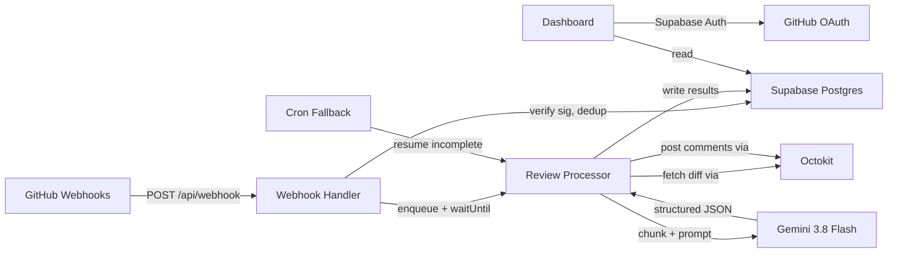
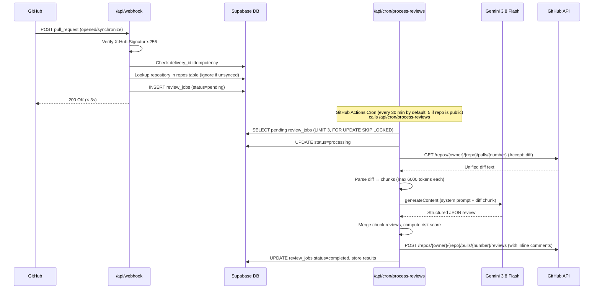

# PRPilot — Architecture

## System Components

## Components

| Component | Technology | Purpose |
|---|---|---|
| Webhook endpoint | Next.js Route Handler (`POST /api/webhook`) | Receives GitHub `pull_request` events |
| Review processor | Background task (`waitUntil`) / Route Handler (`POST /api/cron/process-reviews`) | Primary review processing runs in background via `waitUntil` on webhook receipt; cron route serves as fallback for stuck, queued, or deferred jobs |
| Dashboard UI | Next.js App Router (RSC + client) | Shows repos, reviews, charts |
| Auth | Supabase Auth with GitHub OAuth provider | Sign in, session management |
| Database | Supabase Postgres with RLS | All persistent state |
| AI engine | Gemini API via `@google/genai` | Code review generation via primary model `GEMINI_MODEL` and optional fallback `GEMINI_FALLBACK_MODEL` |
| GitHub integration | Octokit (`@octokit/rest`, `@octokit/auth-app`) | Fetch diffs via `Contents: Read-only` permission (required by GitHub to return PR diffs) and post comments |

## Webhook-to-Comment Pipeline

## Handling Long-Running Reviews on Serverless

**Problem**: Even with Vercel Hobby's 300-second timeout (Fluid Compute, 4h active CPU/month), a very large PR with 15+ files could exhaust the budget or fail mid-processing.

**Solution: `waitUntil` primary + Cron fallback**

### Primary path: `waitUntil` in the webhook handler

1. **Webhook handler** validates signature, deduplicates by delivery ID, inserts a `review_jobs` row (`id`) with `status = 'pending'`, and returns `200 OK` in < 3s with `{ "ok": true, "job_id": id }`.
2. Before returning, it calls `waitUntil(processReview(id))` via `@vercel/functions`. Route handler sets `export const maxDuration = 300`. This runs the review in the background after the response is sent.
3. The `processReview` function:
   - Fetches the diff via Octokit (~1s).
   - Chunks the diff (max 6000 tokens each).
   - Processes chunks sequentially, each taking ~10-20s from Gemini.
   - Uses a **250s hard deadline** (50s safety margin from 300s limit). If time runs out, it saves partial progress and exits.
   - When all chunks complete, merges results, computes risk score, posts the GitHub review comment.
4. With 250s budget and ~15s per chunk, a single invocation handles **~16 chunks** (covering most PRs).

### Fallback path: Cron processor

For jobs that didn't complete in `waitUntil` (very large PRs, or if the function was recycled):

1. **Cron route** (`/api/cron/process-reviews`): Triggered by a GitHub Actions scheduled workflow (`.github/workflows/cron.yml`) every 30 minutes by default (5 minutes if the repository is public) with `CRON_SECRET` header. (Vercel Cron is not used due to Hobby plan daily frequency restrictions).
2. Route sets `export const maxDuration = 300`. Picks jobs with `status = 'processing'` that have been stale for > 3 minutes, or `status = 'pending'` (missed by `waitUntil`). Worst-case stale recovery time: with a 180s (3-minute) stale threshold and a 30-minute cron interval, a stuck job will wait up to ~33 minutes before being picked up and recovered (or ~8 minutes if the public 5-minute schedule is configured).
3. Uses `SELECT ... FOR UPDATE SKIP LOCKED` to prevent duplicate processing.
4. Resumes from the last completed chunk and continues with the same 250s hard deadline budget.

### Why this hybrid works

- **Median latency < 30s**: Most PRs (< 5 files) finish in a single `waitUntil` call, giving near-instant reviews.
- **No extra infrastructure**: Uses Vercel Fluid Compute for execution and free GitHub Actions for the 30-minute (or 5-minute public) schedule trigger.
- **Graceful degradation**: The cron catches anything `waitUntil` misses.
- **Free tier safe**: Fluid Compute only bills active CPU time. I/O wait (Gemini API latency) doesn't count, so typical usage stays well under 4h/month.

**Why not Supabase Edge Functions**: Adds deployment complexity and a second runtime. The Vercel + GitHub Actions cron approach is simpler.

## Failure Handling

| Failure | Mitigation |
|---|---|
| Webhook handler crashes | GitHub retries webhooks (up to 3 times over hours). Idempotency key (delivery_id) prevents duplicates. |
| Gemini API 429 (rate limit) | Exponential backoff. Job stays `processing`; next cron picks it up. Max 5 retries tracked in `review_jobs.retry_count`. |
| Gemini API returns invalid JSON | Zod parse with `.safeParse()`. On failure, retry once with a stricter prompt. After 2 failures, mark job as `error` with reason. |
| GitHub API token expired | Installation tokens last 1 hour. Always mint a fresh token per cron invocation via `@octokit/auth-app`. |
| Cron function timeout | 250s hard deadline (within maxDuration = 300) with try/finally saving partial progress to review_chunks. Next invocation resumes. |
| PR closed before review completes | Check PR state before posting. If closed/merged, mark job `skipped`. |
| Database connection failure | Supabase client retries built-in. Job stays in current state; next cron picks it up. |

## 5 Key Architecture Decisions

### 1. Queue-in-DB instead of external queue (SQS, RabbitMQ, etc.)
A `review_jobs` Postgres table with `SELECT ... FOR UPDATE SKIP LOCKED` acts as a job queue. **Why**: Zero additional infrastructure, free tier compatible, transactional with the rest of the data, and `SKIP LOCKED` prevents duplicate processing if cron overlaps.

### 2. Gemini Model Strategy & Resilience (`GEMINI_MODEL` & `GEMINI_FALLBACK_MODEL`)
The primary model is configured via `GEMINI_MODEL` (default: `gemini-3.8-flash`, configurable to e.g. `gemini-3.5-flash-lite`), offering high throughput, 1M token context, and structured output support. If the primary model encounters temporary service unavailability (HTTP 503), the processor automatically makes fallback attempts using model(s) specified in `GEMINI_FALLBACK_MODEL` (e.g. `gemini-3.5-flash-lite,gemini-2.5-flash`), ensuring resilient reviews even during upstream peak demand. **Why**: Handles diffs efficiently in a single call per chunk with automated fallback resilience, avoiding job abandonment on transient 503 errors.

### 3. `waitUntil` primary + GitHub Actions Cron fallback (not queue-only, not separate worker)
The webhook handler uses `waitUntil` from `@vercel/functions` to process reviews in-band after responding, with a GitHub Actions scheduled workflow (every 30 minutes by default, 5 minutes if the repository is public) as a safety net for incomplete jobs. **Why**: Achieves < 30s median review latency, avoids Vercel Hobby cron limitations, and gracefully handles the 300s timeout with a 250s deadline.

### 4. Supabase Auth with GitHub OAuth (not custom OAuth flow)
Supabase Auth handles the OAuth dance, session tokens, and refresh. **Why**: Eliminates ~300 lines of auth code, provides secure cookie-based sessions via `@supabase/ssr`, and the GitHub provider gives us the user's verified GitHub identity for RLS. The auth callback (`/api/auth/callback`) enforces strict host allow-listing using `NEXT_PUBLIC_APP_URL` and validates relative redirect paths. Required Supabase redirect URL allow-list patterns are `http://localhost:3000/**` and `https://<your-app>.vercel.app/**`; dynamic Vercel preview URLs are not accepted for OAuth unless an account-scoped pattern (e.g. `https://*-<your-team-or-account-slug>.vercel.app/**`) is added to Supabase Auth and `NEXT_PUBLIC_APP_URL` matches the preview host. Dashboard empty states link directly to installation via `NEXT_PUBLIC_GITHUB_APP_INSTALL_URL`.

### 5. Structured output with JSON schema (not free-text parsing)
Gemini's `responseJsonSchema` guarantees the response matches our schema. **Why**: Eliminates fragile regex/markdown parsing, makes the review data type-safe end-to-end, and reduces post-processing code to a single `JSON.parse` + `z.parse`.

## Security Model & GitHub App Permissions

### GitHub App Permissions & Least Privilege
PRPilot operates under least privilege with the following GitHub App permissions:
- **Pull requests**: `Read and write` — Pull requests to read PR metadata and post reviews.
- **Contents**: `Read-only` — Contents read-only because GitHub requires it to return a pull request's diff (read-only: the app cannot change code).
- **Metadata**: `Read-only` — Metadata is mandatory.
- **All other permissions**: `No access`.

### Repository Content Access & AI Processing Boundary
The app can read repository contents of the repositories it is installed on (it only fetches pull request diffs and sends them to the Gemini API for analysis). Users should install it only on repositories they are comfortable sending to Google's Gemini API; the free tier's data-use terms may differ from paid, to be checked by the user.

## Technology Versions

| Package | Version | Notes |
|---|---|---|
| `next` | ^15.x | App Router, Route Handlers |
| `@supabase/ssr` | ^0.5.x | Server-side Supabase client for Next.js |
| `@supabase/supabase-js` | ^2.x | Core Supabase client |
| `@octokit/rest` | ^21.x | GitHub API client |
| `@octokit/auth-app` | ^7.x | GitHub App authentication |
| `@octokit/webhooks-methods` | ^5.x | Webhook signature verification |
| `@google/genai` | ^1.x | Gemini API client |
| `zod` | ^3.x | Runtime validation |
| `@vercel/functions` | ^1.x | `waitUntil` for background processing |
| `recharts` | ^2.x | Dashboard metrics and trend charts |
| `tailwindcss` | ^4.x | Styling |
| `vitest` | ^3.x | Unit/integration tests |
| `@playwright/test` | ^1.x | E2E tests |
