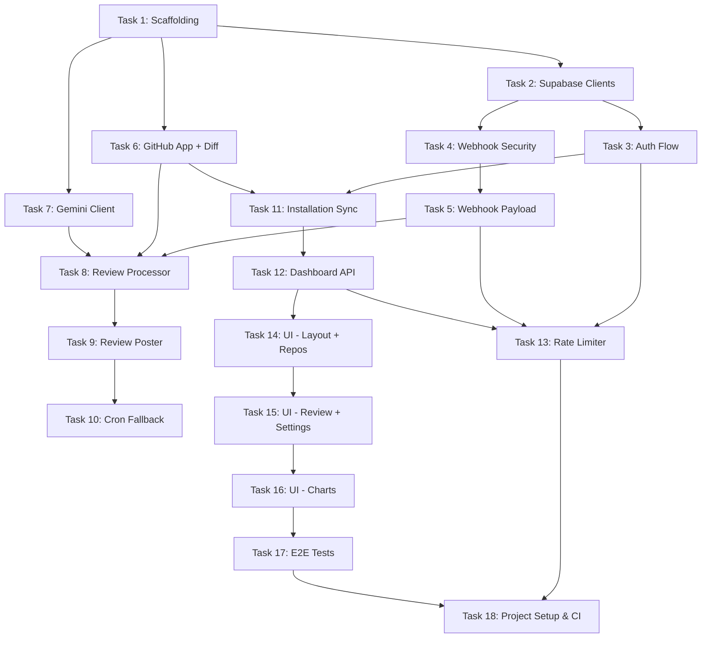

# PRPilot — Build Plan

18 tasks in dependency order. Each task is one Flash session.

---

## Task 1: Project Scaffolding

**Goal**: Initialize the Next.js project with TypeScript, Tailwind CSS, and all dependencies.

**Files to create/edit**:
- `package.json` (created by `create-next-app`)
- `tsconfig.json` (configure `@/` path alias)
- `tailwind.config.ts`
- `.env.local.example` (all env vars from SECURITY.md with placeholder values)
- `.gitignore` (add `.env.local`, `*.pem`)
- `vercel.json` (Vercel config)
- `vitest.config.ts`
- `playwright.config.ts`

**Commands**:
```bash
npx create-next-app@latest . --typescript --tailwind --app --src-dir --use-pnpm
pnpm add @supabase/supabase-js @supabase/ssr @octokit/rest @octokit/auth-app @octokit/webhooks-methods @google/genai zod @vercel/functions
pnpm add -D vitest @testing-library/react @testing-library/jest-dom @playwright/test jsdom
```

**Acceptance criteria**:
- `pnpm dev` starts without errors.
- `pnpm test` runs (no tests yet, but Vitest config works).
- Path alias `@/` resolves correctly.
- `.env.local.example` lists all 9 env vars from SECURITY.md.

**Tests**: None (scaffolding only).

**Pitfalls**: Make sure `src/` directory is used. Tailwind v4 uses CSS-based config, not `tailwind.config.ts` — check which version `create-next-app` installs and adapt accordingly.

---

## Task 2: Supabase Client Helpers

**Goal**: Create the two Supabase client factories and the middleware session refresher.

**Files to create**:
- `src/lib/supabase/server.ts` — `createUserClient()` using `@supabase/ssr` with cookie handling
- `src/lib/supabase/service.ts` — `createServiceClient()` using service role key
- `src/lib/supabase/middleware.ts` — `updateSession()` helper
- `src/middleware.ts` — Next.js middleware that refreshes sessions and guards `/dashboard/*`
- `src/lib/supabase/server.test.ts`
- `src/lib/supabase/service.test.ts`

**Acceptance criteria**:
- `createUserClient()` creates a Supabase client with cookie-based auth.
- `createServiceClient()` creates a Supabase client with service role key (no cookies).
- Middleware redirects unauthenticated users from `/dashboard/*` to `/login`.
- Middleware passes through for `/api/webhook`, `/api/cron/*`, and static assets.

**Tests**:
- Unit test that `createServiceClient` uses the service role key.
- Unit test that middleware redirects unauthenticated requests to `/login`.

**Pitfalls**: In Next.js 15+, `cookies()` is async — must `await cookies()`. The middleware runs on Edge runtime — don't use Node.js-only APIs.

---

## Task 3: Auth Flow (Login + Callback + Signout)

**Goal**: Implement GitHub OAuth login via Supabase Auth.

**Files to create**:
- `src/app/(auth)/login/page.tsx` — Login page with "Sign in with GitHub" button
- `src/app/api/auth/callback/route.ts` — Exchanges code for session, upserts profile
- `src/app/api/auth/signout/route.ts` — Destroys session
- `src/app/(auth)/error/page.tsx` — Auth error page
- `src/app/page.tsx` — Landing page with login CTA

**Acceptance criteria**:
- Clicking "Sign in with GitHub" redirects to GitHub OAuth.
- After OAuth, user is redirected to `/dashboard` with a valid session.
- Profile row is upserted in `profiles` table with GitHub username and avatar.
- Sign out destroys the session and redirects to `/`.

**Tests**:
- Integration test for callback route: mock `exchangeCodeForSession`, verify redirect.
- Integration test for signout route: verify session destruction.

**Pitfalls**: The `provider_token` from GitHub is only available at callback time — capture and use it immediately for profile data, but don't store it. Use the Supabase user metadata (`user.user_metadata.user_name`, `user.user_metadata.avatar_url`) for the profile.

---

## Task 4: Webhook Signature Verification & Idempotency

**Goal**: Build the webhook handler's security layer (no review processing yet).

**Files to create**:
- `src/lib/github/webhooks.ts` — `verifyWebhookSignature(body, signature, secret)` function
- `src/app/api/webhook/route.ts` — POST handler that verifies signature, checks idempotency, returns 200
- `src/lib/github/webhooks.test.ts`
- `src/app/api/webhook/route.test.ts`

**Acceptance criteria**:
- Valid signatures pass verification.
- Invalid/missing signatures return 401.
- Duplicate `X-GitHub-Delivery` IDs return `{ "duplicate": true }`.
- New delivery IDs are stored in `webhook_deliveries`.
- Non-`pull_request` events return `{ "ignored": true }`.

**Tests**:
- Unit test: `verifyWebhookSignature` with valid/invalid HMAC.
- Integration test: POST with valid signature → 200.
- Integration test: POST with invalid signature → 401.
- Integration test: POST with duplicate delivery ID → duplicate response.

**Pitfalls**: Must read the raw request body as text (not JSON) for signature verification. Use `request.text()` then `JSON.parse()` separately. Do NOT use `request.json()` first.

---

## Task 5: Webhook Payload Processing & Job Enqueueing

**Goal**: Parse the PR webhook payload and create a review job in the database.

**Files to edit**:
- `src/app/api/webhook/route.ts` — Add payload validation and job creation after signature check

**Files to create**:
- `src/lib/review/processor.ts` — Stub with `processReview(id)` function (implementation in Task 8)

**Acceptance criteria**:
- Valid `pull_request` payloads (opened/synchronize/reopened) create a `review_jobs` row (`id`) with status `pending`.
- The response includes `{ "ok": true, "job_id": id }` where `job_id` references `review_jobs.id`.
- The handler calls `waitUntil(processReview(id))` to trigger background processing; route sets `export const maxDuration = 300`.
- Invalid payloads (Zod validation failure) return 400.
- Repos not found in the database are handled gracefully (repo may not be synced yet — log and return 200).

**Tests**:
- Integration test: valid PR payload → job created in DB.
- Integration test: invalid payload → 400.
- Unit test: `WebhookPullRequestSchema` validates correct payloads and rejects bad ones.

**Pitfalls**: The `installation.id` in the webhook may correspond to a repo not yet synced. Don't crash — return 200 with `{ "ignored": true, "reason": "repo_not_found" }`. This prevents GitHub from retrying endlessly.

---

## Task 6: GitHub App Client & Diff Fetching

**Goal**: Create the GitHub App authentication client and diff fetcher.

**Files to create**:
- `src/lib/github/app.ts` — `getInstallationOctokit(installationId)` function
- `src/lib/github/diff-parser.ts` — `fetchDiff(octokit, owner, repo, prNumber)` and `parseDiff(diffText)` → `DiffChunk[]`
- `src/lib/github/diff-parser.test.ts`
- `src/__fixtures__/sample-diff.txt` — A realistic sample unified diff for testing

**Acceptance criteria**:
- `getInstallationOctokit()` returns an authenticated Octokit instance for the given installation.
- `fetchDiff()` fetches the PR diff using `mediaType: { format: 'diff' }`.
- `parseDiff()` splits a unified diff into per-file chunks, each under `MAX_CHUNK_TOKENS`.
- Large files are split into multiple chunks.
- Files matching `ignored_paths` patterns are filtered out.

**Tests**:
- Unit test: `parseDiff` with sample diff → correct number of chunks, correct file paths.
- Unit test: `parseDiff` with a large file → splits into multiple chunks.
- Unit test: `parseDiff` with ignored paths → filters them out.

**Pitfalls**: GitHub's diff endpoint returns plain text, not JSON. The response type will need a cast: `response.data as unknown as string`. Diff parsing must handle files with no changes (mode-only changes) gracefully.

---

## Task 7: Gemini AI Review Client

**Goal**: Build the Gemini API client that sends a diff chunk and receives a structured review.

**Files to create**:
- `src/lib/gemini/client.ts` — `createGeminiClient()` using `@google/genai`
- `src/lib/gemini/review.ts` — `reviewChunk(chunk, context)` → `ChunkReviewResult`
- `src/lib/gemini/review.test.ts`
- `src/__fixtures__/sample-review-response.json` — A valid `ChunkReviewResult` JSON for testing

**Acceptance criteria**:
- `reviewChunk()` constructs the prompt using the template from PROMPTS.md.
- Uses `responseJsonSchema` with the `ChunkReviewResultSchema` Zod schema converted to JSON Schema.
- Parses and Zod-validates the response.
- On invalid JSON, retries once with a stricter prompt.
- Returns a validated `ChunkReviewResult`.

**Tests**:
- Unit test: mock Gemini API → valid response → correctly parsed.
- Unit test: mock Gemini API → invalid JSON → retries, then returns error.
- Unit test: verify the prompt includes all template variables.
- Unit test: verify `temperature` is 0.2 and `maxOutputTokens` is 4096.

**Pitfalls**: The `responseJsonSchema` config requires the Gemini SDK's `Type` enum for schema definition, NOT a Zod schema directly. Convert the Zod schema to a JSON-schema-like object using `Type.OBJECT`, `Type.ARRAY`, `Type.STRING`, etc. See PROMPTS.md for the exact config shape.

---

## Task 8: Review Processor (Orchestrator)

**Goal**: Implement the main review processing pipeline that fetches diff, chunks, reviews, and saves results.

**Files to edit**:
- `src/lib/review/processor.ts` — Full implementation of `processReview(jobId)`

**Files to create**:
- `src/lib/review/merger.ts` — `mergeChunkResults(chunks)` → `FullReviewResult`
- `src/lib/review/merger.test.ts`
- `src/lib/review/processor.test.ts`

**Acceptance criteria**:
- Fetches the diff via Octokit.
- Chunks the diff using `parseDiff()`.
- Filters out ignored paths using repo settings.
- Creates `review_chunks` rows.
- Reviews each chunk sequentially via `reviewChunk()`.
- Saves chunk results to DB.
- Uses a 250s hard deadline; saves partial progress if time runs out.
- When all chunks complete, calls `mergeChunkResults()` to compute the final `FullReviewResult`.
- Updates `review_jobs` status to `completed` (or `error` with message).
- Handles retry logic (increment `retry_count`, max 5).

**Tests**:
- Integration test: mock all dependencies → happy path → job completed.
- Integration test: Gemini failure → job stays processing with incremented retry count.
- Unit test: `mergeChunkResults` correctly sums severity counts and computes risk score.
- Unit test: risk score formula matches PROMPTS.md (25×critical + 10×warning + 3×suggestion, capped at 100).

**Pitfalls**: Use `Date.now()` deadline tracking, not `setTimeout`. The deadline must be checked BETWEEN chunks, not during. If a chunk is in progress when the deadline hits, let it complete (don't interrupt the Gemini call).

---

## Task 9: GitHub Review Poster

**Goal**: Post the assembled review as a GitHub PR review with inline comments.

**Files to create**:
- `src/lib/review/poster.ts` — `postReviewToGitHub(octokit, owner, repo, prNumber, commitSha, result)` function
- `src/lib/review/poster.test.ts`

**Files to edit**:
- `src/lib/review/processor.ts` — Call `postReviewToGitHub()` after merge is complete

**Acceptance criteria**:
- Posts a single GitHub PR review with the summary comment body (from PROMPTS.md template).
- Includes inline comments in the `comments` array of `createReview()`.
- Maps `AIInlineComment` to GitHub's `{ path, line, side, body }` format.
- Comment body includes severity emoji + title + body.
- If suggestion code exists, wraps it in a GitHub suggestion block (` ```suggestion `).
- Saves the `github_review_id` to the `reviews` table.
- Handles cases where the PR was closed/merged: check PR state first, mark job `skipped`.

**Tests**:
- Unit test: correct mapping of `AIInlineComment` to GitHub review comment format.
- Unit test: suggestion code is wrapped in ` ```suggestion ` block.
- Unit test: summary comment includes risk score, severity counts, and duration.
- Integration test: mock Octokit → verify `pulls.createReview` called with correct params.

**Pitfalls**: GitHub's `line` field in review comments must correspond to a line in the diff. If the AI returns a line number not in the diff hunk, the API will reject it. Wrap each comment posting in try/catch and skip invalid line numbers rather than failing the entire review.

---

## Task 10: Cron Fallback Processor

**Goal**: Implement the cron route and GitHub Actions scheduled workflow that picks up incomplete/missed review jobs.

**Files to create**:
- `src/app/api/cron/process-reviews/route.ts`
- `src/app/api/cron/process-reviews/route.test.ts`
- `.github/workflows/cron.yml` — Scheduled GitHub Actions workflow running every 5 minutes

**Acceptance criteria**:
- Requires `Authorization: Bearer <CRON_SECRET>`.
- Route sets `export const maxDuration = 300` with an internal 250s hard deadline budget.
- Selects jobs with `status = 'processing'` stale for > 3 min, or `status = 'pending'`.
- Uses `SELECT ... FOR UPDATE SKIP LOCKED LIMIT 3`.
- Calls `processReview()` for each job (reusing Task 8 logic and Task 9 review posting).
- Returns `{ "processed": N, "jobs": ["<id>", ...] }` matching API.md.
- `.github/workflows/cron.yml` runs every 5 minutes (`*/5 * * * *`) and triggers the endpoint with `CRON_SECRET`.
- Does not process if no pending work (`{ "processed": 0 }`).

**Tests**:
- Integration test: valid CRON_SECRET → processes pending jobs.
- Integration test: invalid CRON_SECRET → 401.
- Integration test: no pending jobs → `{ "processed": 0 }`.

**Pitfalls**: The `FOR UPDATE SKIP LOCKED` query must use the Supabase service client with raw SQL (`rpc` or `.sql()`), since the PostgREST API doesn't support `FOR UPDATE SKIP LOCKED`. Use `supabase.rpc()` or a Postgres function. Vercel Cron is not used due to Hobby plan frequency limits; GitHub Actions scheduled workflow handles the 5-minute schedule.

---

## Task 11: Installation Sync & Repo Management

**Goal**: Sync GitHub App installations and their repos into the database.

**Files to create**:
- `src/app/api/installations/sync/route.ts`
- `src/app/api/installations/sync/route.test.ts`

**Acceptance criteria**:
- Authenticated user calls POST → fetches their GitHub App installations via Octokit.
- Upserts `installations` and `repos` rows.
- Creates default `repo_settings` for new repos.
- Returns `{ installations: N, repos: N }`.
- Handles the case where the user has no installations gracefully.

**Tests**:
- Integration test: mock Octokit → repos synced correctly.
- Integration test: unauthenticated → 401.

**Pitfalls**: To list user's installations, you need the App-level Octokit, then filter by the user's GitHub account. The user's `github_user_id` from `profiles` is used to match. Alternatively, if the user installed the app, the `installation.account.login` matches their GitHub username.

---

## Task 12: Dashboard API Endpoints

**Goal**: Implement all dashboard data endpoints.

**Files to create**:
- `src/app/api/repos/route.ts` — GET repos list with aggregated stats
- `src/app/api/repos/[repoId]/reviews/route.ts` — GET paginated review history
- `src/app/api/repos/[repoId]/reviews/[reviewId]/route.ts` — GET single review with comments
- `src/app/api/repos/[repoId]/stats/route.ts` — GET severity breakdown + risk trend
- `src/app/api/repos/[repoId]/settings/route.ts` — GET + PATCH repo settings
- Test files for each route

**Acceptance criteria**:
- All endpoints use `createUserClient()` (RLS-protected).
- Pagination works correctly (page/limit params, total count).
- Stats endpoint returns correct aggregations over the `days` param.
- Settings PATCH validates with `RepoSettingsUpdateSchema`.
- 404 for repos the user doesn't own (enforced by RLS).

**Tests**:
- Integration tests for each endpoint with mocked Supabase.
- Test that RLS prevents cross-user access (mock different auth.uid()).

**Pitfalls**: In Next.js 15+, `params` is a Promise — must `await context.params`. Don't forget this for the `[repoId]` and `[reviewId]` dynamic segments.

---

## Task 13: Rate Limiter

**Goal**: Add rate limiting to all API endpoints.

**Files to create**:
- `src/lib/rate-limit.ts` — In-memory sliding window rate limiter
- `src/lib/rate-limit.test.ts`

**Files to edit**:
- `src/app/api/webhook/route.ts` — Add rate limiting (60/min per IP)
- `src/app/api/repos/route.ts` and other dashboard routes — Add rate limiting (30/min per user)
- `src/app/api/auth/callback/route.ts` — Add rate limiting (10/min per IP)

**Acceptance criteria**:
- Rate limiter uses a sliding window algorithm.
- Returns 429 with `ApiError` shape when limit exceeded.
- Different limits for webhook (60), dashboard (30), auth (10).
- Cleans up expired entries to prevent memory leaks.

**Tests**:
- Unit test: rate limiter allows requests under limit.
- Unit test: rate limiter blocks requests over limit.
- Unit test: rate limiter resets after window expires.

**Pitfalls**: In-memory rate limiting resets on cold starts (Vercel creates new instances). This is acceptable for v1 — it still prevents burst abuse within a single instance. For production, consider Upstash Redis.

---

## Task 14: Dashboard UI — Layout & Repos Page

**Goal**: Build the dashboard shell and repos list page.

**Files to create**:
- `src/app/layout.tsx` — Root layout with Tailwind, dark mode support
- `src/app/dashboard/layout.tsx` — Dashboard layout with sidebar + header
- `src/components/layout/header.tsx` — Header with user avatar, sign out
- `src/components/layout/sidebar.tsx` — Sidebar with repo list navigation
- `src/app/dashboard/page.tsx` — Repos list with cards
- `src/components/dashboard/repo-card.tsx` — Card showing repo name, review count, avg risk score
- `src/components/ui/button.tsx`, `card.tsx`, `badge.tsx` — Basic UI primitives

**Acceptance criteria**:
- Dashboard layout renders with sidebar and header.
- Repos page fetches from `/api/repos` and displays cards.
- Each card shows repo name, total reviews, and average risk score with color coding.
- Responsive layout (sidebar collapses on mobile).
- Loading and empty states handled.

**Tests**:
- Component test: `RepoCard` renders with correct data.
- Component test: repos page shows loading state.
- Component test: repos page shows empty state when no repos.

**Pitfalls**: Use React Server Components (RSC) for data fetching where possible. Only add `'use client'` for interactive components (sidebar toggle, buttons with onClick). Don't fetch data in client components — fetch in RSC and pass as props.

---

## Task 15: Dashboard UI — Review Detail & Settings

**Goal**: Build the repo detail page, review detail page, and settings page.

**Files to create**:
- `src/app/dashboard/[repoId]/page.tsx` — Review history list
- `src/components/dashboard/review-list.tsx` — List of reviews with risk score badges
- `src/app/dashboard/[repoId]/reviews/[reviewId]/page.tsx` — Full review with inline comments
- `src/components/dashboard/review-detail.tsx` — Review summary + comment list
- `src/app/dashboard/[repoId]/settings/page.tsx` — Settings form
- `src/components/dashboard/settings-form.tsx` — Form for ignored paths, strictness, custom instructions

**Acceptance criteria**:
- Review list page shows paginated reviews for the repo.
- Review detail page shows summary, risk score, severity counts, and all inline comments.
- Inline comments show severity icon, file path, line number, title, body, and suggestion.
- Settings page shows current settings and allows editing.
- Settings form validates and saves via PATCH endpoint.
- Success/error toast on save.

**Tests**:
- Component test: review detail renders all comment fields.
- Component test: settings form submits correctly.

**Pitfalls**: The `[repoId]` param in layouts/pages is a Promise in Next.js 15+. Handle the settings form as a client component with `'use client'` and `useState`. Use optimistic UI or a simple submit + refetch.

---

## Task 16: Dashboard UI — Charts

**Goal**: Add severity breakdown and risk score trend charts.

**Files to create**:
- `src/components/dashboard/severity-chart.tsx` — Stacked bar chart for severity breakdown
- `src/components/dashboard/risk-trend-chart.tsx` — Line chart for risk score trend

**Files to edit**:
- `src/app/dashboard/[repoId]/page.tsx` — Add charts above the review list

**Dependencies to add**:
- `recharts` (lightweight charting library, works with RSC pattern via client component)

**Acceptance criteria**:
- Severity chart shows stacked bars (critical=red, warning=yellow, suggestion=blue, praise=green) by date.
- Risk trend chart shows a line plot of average risk score over time.
- Charts are responsive.
- Empty state when no data.
- Date range selector (7d, 30d, 90d).

**Tests**:
- Component test: chart renders without crashing with sample data.
- Component test: empty state renders correctly.

**Pitfalls**: Charts must be client components (`'use client'`). Fetch data in the parent RSC and pass as props. `recharts` uses SVG — ensure it's imported correctly for SSR (dynamic import with `ssr: false` if needed).

---

## Task 17: E2E Tests

**Goal**: Write Playwright E2E tests for the critical user flows.

**Files to create**:
- `e2e/auth.spec.ts` — Login → redirect to dashboard → sign out
- `e2e/dashboard.spec.ts` — View repos → view reviews → view review detail
- `e2e/webhook.spec.ts` — Simulate webhook → verify job created → verify review posted (mock GitHub API)
- `e2e/settings.spec.ts` — Update repo settings → verify saved

**Acceptance criteria**:
- All E2E tests pass against a local dev server with test database.
- Auth flow uses mocked GitHub OAuth (Supabase test user).
- Webhook test sends a real HTTP POST with valid signature.
- Tests run in CI via `pnpm exec playwright test`.

**Tests**: This task IS the tests.

**Pitfalls**: Playwright needs a running dev server. Use `webServer` config in `playwright.config.ts`. For auth, create a test user directly in Supabase via service role, or use Supabase's email/password auth for testing (simpler than mocking OAuth in E2E).

---

## Task 18: Project Setup & CI

**Goal**: Prepare documentation, Vercel project configuration, and GitHub Actions CI. Deployment is handled natively via Vercel's GitHub integration on push to main.

**Files to create**:
- `.github/workflows/ci.yml` — Lint, type-check, unit tests, E2E tests
- `README.md` — Project setup, Vercel project configuration, GitHub App configuration, and all 9 env vars

**Files to edit**:
- `package.json` — Add scripts: `lint`, `type-check`, `test`, `test:e2e`

**Acceptance criteria**:
- CI runs on every PR: `pnpm lint`, `tsc --noEmit`, `pnpm test`, `pnpm exec playwright test`.
- CI installs Playwright browsers.
- README clearly documents Vercel GitHub integration setup and all 9 environment variables from SECURITY.md.
- GitHub Actions cron workflow (`.github/workflows/cron.yml` from Task 10) verified with `CRON_SECRET`.

**Tests**: CI tests are meta-tests (testing the testing infrastructure).

**Pitfalls**: GitHub Actions needs env vars for tests (Supabase URL, anon key). Use GitHub Secrets for sensitive ones. Playwright in CI needs `--reporter=github` for inline annotations. Make sure `pnpm install --frozen-lockfile` is used in CI.

---

## Dependency Graph



> [!IMPORTANT]
> Tasks 6 and 7 can run in parallel with Tasks 3-5. Task 13 can run after Tasks 3, 5, and 12 are completed.
